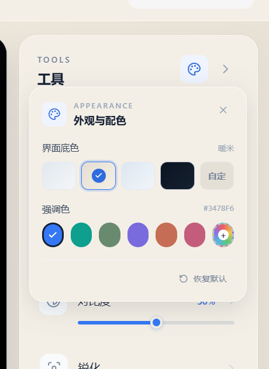

# 口腔内窥相机系统

面向口腔诊所的医疗影像工作台，支持 Windows 与 Apple Silicon Mac。采用 React + Tailwind CSS 构建，Electron 提供桌面窗口、原生窗口控制与 USB 摄像头访问能力。

GitHub 仓库：<https://github.com/Aliaosha-code/dental-intraoral-camera>


## 环境要求

- Node.js 20+
- Windows 10 / 11，或 macOS 12+（M1 / M2 / M3 / M4）

## 运行方式

```bash
npm install
```

启动桌面应用：

```bash
npm run start
# 等价于 npm run electron:start
```

应用启动后会自动发现并连接 USB 摄像头，优先选择名称中包含 `Supereyes`、`USB`、`UVC`、`Intraoral` 等标识的影像设备。

浏览器预览（开发模式）：

```bash
npm run dev
```

打开 <http://localhost:5178>。浏览器运行时需要允许页面访问摄像头。

仅构建前端资源：

```bash
npm run build
```

Windows 安装包：

```bash
npm run dist:win
```

## macOS 打包（Apple Silicon）

macOS 安装包需要在 Mac 上构建：

```bash
npm run dist:mac
```

输出目录为 `release/`，包含 Apple Silicon（arm64）的 `.dmg` 和 `.zip`。仅生成未压缩的 `.app`：

```bash
npm run dist:mac:dir
```

macOS 首次启动时会请求摄像头权限，请在「系统设置 → 隐私与安全性 → 摄像头」中允许。`npm run dist:mac` 默认生成未签名开发包，适合本机验证；正式分发请按 [macOS 发布签名与公证](docs/MACOS_RELEASE.md) 配置 Developer ID 签名和 notarize。

## 当前功能

- 三栏工作台布局，实时预览区占据最大空间，左右侧栏与底部胶片条均可折叠。
- 启动后自动连接 USB 摄像头，显示设备名、实际采集分辨率与帧率。
- 工具栏包含增强、曝光、亮度、对比度、锐化、标注、测量与全屏。
- 曝光滑块直接控制摄像头硬件曝光，并可一键恢复自动曝光。
- 亮度、对比度、增强与锐化实时作用于视频流；标注、测量可直接在画面上操作，测量结果为未标定参考值，不用于临床计量。
- 外观设置：点击工具栏右上角调色盘，可切换「暖米 / 柔和灰 / 雾蓝 / 深色」底色，也可选择任意自定义背景色。
- 强调色支持医疗蓝、青绿、鼠尾草、紫罗兰、陶土、玫瑰及任意自定义颜色；主题与颜色会保存在本机。
- 默认使用低眩光暖米主题，降低长时间观看时的白色刺眼感。



- 针对实时视频优化渲染：默认不启用视频滤镜、移除覆盖层毛玻璃，并关闭 Electron 窗口遮挡降频，减少合成卡顿。
- 患者信息、检查日期与检查图像列表保持空状态，等待接入诊所真实数据或拍摄流程，不内置患者资料或检查影像。

## 平台差异

- Windows 使用自定义无边框标题栏和窗口控制按钮。
- macOS 使用 `hiddenInset` 原生窗口样式，左上角为系统原生红黄绿窗口按钮，应用内容自动避开交通灯区域。

## 相机说明

摄像头访问基于 `navigator.mediaDevices.getUserMedia`。默认请求 `1280 × 720 / 30 FPS`，实际分辨率以设备能力为准。若摄像头被其他程序占用或权限被拒绝，预览区会显示具体原因和「重新连接摄像头」按钮。

患者的真实资料和检查影像属于后续业务接入范围：

- 患者资料可从诊所 HIS/电子病历系统读取；
- 检查图像列表可接入拍摄保存流程后写入 `src/data/images.js`；
- 待数据接入后，胶片条仍支持横向滚动、蓝色选中边框和折叠。

## 目录结构

```text
electron/              Electron 主进程、preload、macOS 权限与图标
scripts/               Electron 启动脚本、图标生成脚本
src/
  components/          TitleBar / PatientPanel / PreviewStage / ToolsPanel / ImageStrip / AppearancePanel
  data/images.js       患者与检查影像数据入口（当前为空）
  hooks/useCamera.js   USB 摄像头枚举、选择、取流、曝光与状态管理
  theme.js             主题预设、强调色生成与本地外观配置
  App.jsx              工作台状态与布局
  index.css            Tailwind CSS、主题变量与全局样式
```

## 许可证

本项目采用 [MIT License](./LICENSE) 开源。
